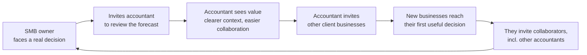

# The Bet · FinWise

> Module 1 · Ignite a PLG Motion. The growth hypothesis and where you're betting, plus the growth-loop visualization.

## Growth hypothesis

FinWise's biggest growth problem is that it loses 98% of trial users before they pay. Trial-to-paid conversion has stayed between 1.87% and 2.08% every month, while more customers churn than convert. This happens because trial users use the features but don’t reach an outcome that matters to their business. Import and modeling usage roughly doubled with no change in conversion. Value comes from a forecast tied to a real decision, such as a new contract, a hire or a tax payment, not from feature activity. Those decisions are usually reviewed with an accountant or partner, so the value moment is naturally collaborative.

_Working notes: I think FinWise’s biggest problem is activation. Trial users have full premium access but never reach a meaningful first outcome during the reverse trial. The experience is generic and isn’t tied to their business’s real financial decisions. Value is available but not experienced, so few convert, and those who pay don’t stay. Evidence: Only 2% of trial users convert, even with full premium access. In a reverse trial, access isn’t the barrier. If users don’t pay after trying everything, they didn’t experience the value. This is an Activation → Revenue drop-off. 60% of paying customers churn within a year. Even people who paid didn’t keep getting value. This points to the same root cause one stage later, in Retention. More acquisition spend no longer drives growth. The constraint is downstream of Acquisition. Acquisition spend alone isn’t a self-sustaining loop: more users flowing into a trial that doesn’t activate them just leak out. Supporting qualitative signal (n=1, to validate): I interviewed a senior accountant who serves SMBs for this class. She said the most valuable capability is forward-looking. That means forecasting a contract’s costs, margin and cash needs before signing. Basic bookkeeping is less valuable. That suggests what the “aha” moment should be. Against the data: The data confirmed my diagnosis: FinWise loses most users between trial and paid, and acquisition isn’t the lever. But it challenged my assumption about activation. Import and modeling usage rose sharply without moving conversion, so feature usage isn’t the value moment. I refined my hypothesis to focus on a forecast tied to a real business decision, and I’d validate that signal with user-level data before testing it._

_____

## The bet

A 50/50 A/B test against current onboarding over one full trial cycle. The test variant asks new trial users what decision they’re facing, guides them to a decision-linked forecast, and lets them invite their accountant or partner to review it. Primary metric: share of trial users who complete a decision-linked forecast. Before launch, validate with user-level data that this behaviour predicts conversion. Secondary metrics: invite rate, and the share of invited reviewers who start their own trial. Follow-ups: trial-to-paid conversion, and 90-day paid retention. Guardrails: onboarding drop-off and day-1 drop-off.

**Not doing:**

- Not investing more in acquisition. I’m betting the problem is value, not traffic. That means accepting flat trial volume in the short term.
- Not changing pricing, the paywall or the downgrade moment. The trial → paid gap could partly be a pricing or communication problem. I’m leaving that untested for now so I can isolate the effect of activation.
- Not prioritizing retention fixes for current paying customers, even though churn exceeds new paid every month. I’m betting that better activation creates customers who stay longer, so I’m fixing the inflow first.
- Not building referral or content loops yet. Referral needs satisfied customers, and content feeds acquisition, which isn’t the bottleneck.
- Not optimizing for conversion directly in this test. At about 500 trials a month, a conversion lift of 2% → 2.5% would take years to detect. So I’m relying on a leading indicator, and I accept the risk that it might turn out to be the wrong signal.
- Adding friction on purpose. The intake questions and the invite step add effort at the start of the trial. I’m betting that relevance outweighs that cost, and the drop-off guardrails will show me if I’m wrong.

_____

## Growth loop

**Loop type:** Collaboration. I’d test the collaboration loop first. My refined hypothesis is that FinWise’s value moment is a forecast tied to a real business decision, such as a new contract, a hire or a tax payment. Small businesses rarely make those decisions alone; they review them with their accountant or a partner. Letting users invite that person into the forecast builds sharing into the moment of value. Each activated user brings in a new user who sees real value on the first visit, with real numbers and real stakes already in place. An accountant who finds it useful can then bring in their own clients, which restarts the loop.

Why this loop and not the others:

- Referral depends on satisfied paying customers. With 2% trial-to-paid conversion and more customers churning than converting every month, there aren’t enough of them yet to fuel it.
- Content-driven loops mainly feed acquisition. The data shows acquisition isn’t the bottleneck: visits barely affect trial volume.
- Collaboration targets the Activation stage, where my hypothesis says the problem lies. It also brings in better-qualified users without relying on paid acquisition, which has stopped driving growth.

How I’d know it works: the invite rate (the share of activated users who invite a reviewer) and reviewer conversion (the share of invited reviewers who start their own trial). If either stays near zero, the loop isn’t generating new users for its next cycle.

_____

## Refined loop: the accountant as multiplier

_Added for the final project (October 2026). The loop above ends when an invited reviewer starts a trial. This refinement shows how the accountant helps FinWise spread across businesses, and what turns one round of expansion into a repeating loop._

**The cycle:**

1. An SMB owner invites their accountant to review a financial decision in FinWise.
2. The accountant experiences value: clearer financial context and easier collaboration with the owner.
3. The accountant invites other client businesses, because using FinWise together could make their work easier and involve them earlier in decisions.
4. Those businesses invite other collaborators, potentially including additional accountants, who introduce FinWise to more businesses.

**One round vs a loop.** One accountant bringing ten clients is one round of expansion. It becomes a repeating loop only when those new users generate further invitations.

**The insight to test: motivation.** The accountant recommends FinWise because it improves their own work and client relationships, not because of a reward. That is a hypothesis worth testing.

**How I'd measure it:**

- **Reach:** the percentage of invited accountants who bring in another business.
- **Value:** how many of those businesses reach their first useful financial decision.

Invitations alone wouldn't show that the loop delivers value, so they don't count as success on their own.

_____
